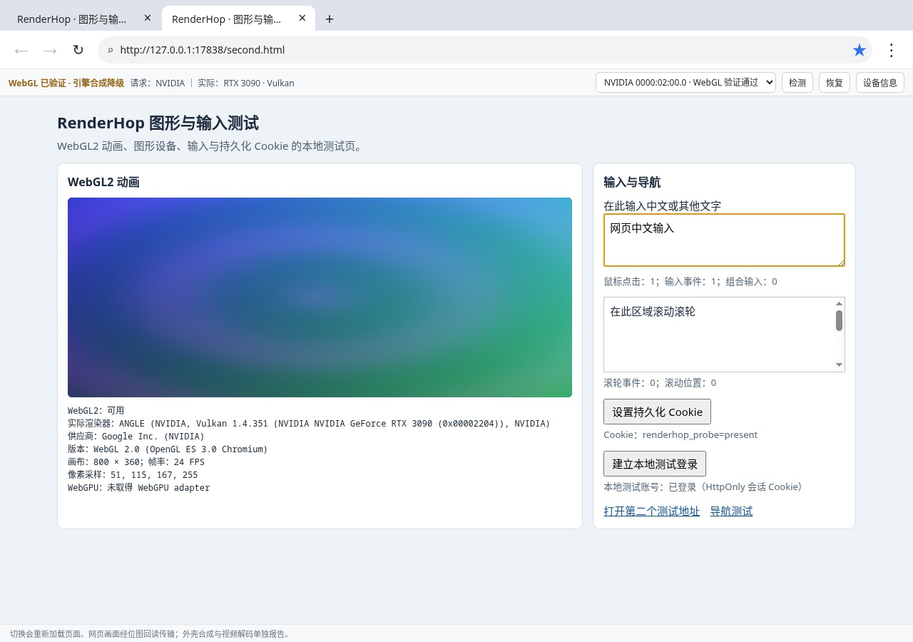

# RenderHop · 跃显浏览器

在当前 Linux 桌面上运行的 Chromium 浏览器。网页由独立 Electron browser instance 渲染，外壳窗口接收它的离屏位图。切换 GPU 会退出并重建网页引擎，外壳保持打开；**页面会重新加载**。

当前为 **0.1.0 实验版本**：已在下述 Intel + RTX 3090 电脑上完成真实渲染和运行中切换验证，仍存在帧率限制、位图传输开销和 NVIDIA 合成降级。它采用 Chrome 常见界面布局与基础操作，尚不具备完整 Chrome 的功能与兼容性。请先阅读下方的“首版边界”和“待解决的问题”。



## 启动

当前机器已经安装依赖，可直接在项目目录执行：

```bash
npm start
```

全新检出先执行 `npm ci`。项目 `.npmrc` 禁止依赖安装脚本，不会另行下载 Electron；使用已有 `/usr/bin/electron43`。需要 Node.js、npm、`electron43`、`pciutils`，以及可访问的 Wayland/XWayland、Mesa Intel 和 NVIDIA/Vulkan 驱动。启动环境须能访问 `/dev/dri`、NVIDIA 设备和当前桌面 socket；不要从隐藏这些设备的容器里判断 GPU 是否可用。无需 root。

本机实测：Arch Linux，KDE Plasma/Wayland，内核 `7.2.14-arch1-1.1`，Electron `43.8.7` / Chromium `150.0.7871.250`，NVIDIA `615.78.08`，Intel `8086:7d51` 与 RTX 3090 `10de:2204`。每次启动仍会重新发现设备，不依赖这些历史编号。

尚未提供 AppImage、deb/rpm 或其他发行包。`npm start` 需要上述系统运行时及图形驱动；其他发行版、Electron 版本或硬件组合不能直接沿用本机通过结论。

## 使用

- 地址栏输入网址或搜索内容；`+` / `Ctrl+T` 新建标签，`×` / `Ctrl+W` 关闭，`Ctrl+Tab` / `Ctrl+Shift+Tab` 切换。
- `Ctrl+L` 地址栏，`Ctrl+R` / `F5` 刷新，`Alt+←/→` 后退/前进。网页支持鼠标、滚轮、键盘、中文提交、复制粘贴。
- 界面参考 Chrome 常用布局：浅色标签栏、圆角地址栏、收藏星标和三点菜单。`Ctrl+D` 收藏/移除当前页，`Ctrl+H` 历史记录，`Ctrl+Shift+O` 书签，`Ctrl+F` 页内查找，`Ctrl++/-/0` 缩放/重置。书签和最近 500 个不同地址的历史保存于自己的 `library.json`。
- 工具栏选择 Intel 或 NVIDIA，即开始全局换卡。标签 URL、顺序、当前标签恢复到同一网页资料；所有网页标签属于同一个引擎。
- 选择器区分“仅检测到硬件”“驱动就绪 / 待验证”“WebGL 验证通过”“验证失败”。**驱动节点存在不等于已证明能渲染。** 选择设备后才执行真实渲染验证。
- 状态栏同时显示请求与实际 WebGL 渲染器。“设备信息”可查看 PCI、驱动、原始 WebGL/Electron/进程设备证据以及 WebGPU 能力。“检测”重新发现设备并使非活动设备的旧验证失效；“恢复”重建可用引擎。
- 初始页和新标签为项目自带的本地图形/输入测试页。可点“设置持久化 Cookie”和“建立本地测试登录”，再换卡观察两者延续。

网页资料位于 `.renderhop/default/web-profile`，外壳资料在 `.renderhop/default/shell`，标签快照在 `.renderhop/default/tabs.json`。均已 Git 忽略。不会读取或改动 Helium/Chrome 资料。`RENDERHOP_DATA_DIR` 可指定 RenderHop 数据根目录；`RENDERHOP_ELECTRON` 可指定另一个 Electron 可执行文件，但其他版本尚未验证。

## 验证与证据

```bash
npm test                 # 编译 + 设备/校验/导航边界回归
npm run test:integration # 真桌面、真实 GPU、自动化验收；会打开并关闭专用测试窗口
```

集成测试使用独立 `.renderhop/test-时间戳` 资料，固定回环端口 17838；正常应用使用 17837。测试不会关闭其他浏览器、调整系统显卡、修改驱动或触碰其他项目。输出 `evidence/run-时间戳/acceptance.json`、`events.jsonl`、引擎日志和切换截图。失败记录同样保留，不能当成通过证据。测试账号只属于本地 fixture，未访问私人账号。

详见 [实测结果](docs/VALIDATION.md) 与 [架构](docs/ARCHITECTURE.md)。

### 已完成的实机验收

| 项目 | 结果 |
| --- | --- |
| Intel WebGL2 | 实际渲染器为 Mesa Intel Graphics (ARL)，GPU 进程 DRM PCI 与非零 render 时间匹配 |
| NVIDIA WebGL2 | 实际渲染器为 RTX 3090 / ANGLE Vulkan，非零绘制像素及 `nvidia-smi` GPU 进程交叉确认 |
| 运行中切换 | 三轮 Intel → NVIDIA → Intel，外壳进程和窗口不退出 |
| 浏览与资料交接 | HTTPS、多标签导航、中文提交、持久 Cookie 和本地 HttpOnly 登录会话通过 |
| 故障处理 | 模拟目标不可用、实际渲染器不匹配时回退、强制引擎退出后恢复通过 |
| Chrome 常用操作 | 书签、历史、页内查找、缩放通过；持久 Cookie、标签和书签跨整个应用重启恢复 |

这些结果对应仓库中保留的 [完整验收数据](evidence/run-1793882593439/acceptance.json)、[重启验收](evidence/run-1793882708019/acceptance.json) 和截图，不包含物理拔卡、真实外部账号登录或全站兼容性保证。早期失败记录用于诊断，不代表最终版本通过。

## 首版边界

- 切换重新加载网页；不保留 JS 内存、未提交表单、WebGL 资源、通话、WebSocket 或标签内前进后退历史。标签本身的 URL、顺序、选中项保留。
- 持久 Cookie、localStorage 等由同一 Chromium profile 延续。会话 Cookie（包括 HttpOnly）在外壳内存中交接；正常关闭整个应用会结束这份逻辑会话。已验本地持久 Cookie 与服务端登录 fixture，未登录外部真实账号，不能保证所有网站的风控与认证机制。
- 当前可行 NVIDIA 路线依赖现有 **XWayland + ANGLE Vulkan**；可见外壳仍为原生 Wayland。原生 Wayland Vulkan 实测出现 GPU 进程故障，不能宣称全原生 Wayland 引擎。
- NVIDIA 的 **WebGL 确实在 RTX 3090 渲染**，但 Chromium 引擎合成报告 `disabled_software`，界面以黄色“引擎合成降级”标出；不能把它说成整条网页合成链都由 NVIDIA 加速。Intel 引擎合成报告 `enabled`。本机 NVIDIA 首个离屏 WebGL 上下文还会丢失，程序有限次重建探针，必须取得有效像素后才恢复用户标签。
- 位图回读、JPEG 90 编码、IPC、图像解码均有 CPU/带宽开销，存在画质损耗；**当前代码主动设置 24 FPS 目标上限**，实测外壳约收到 23–24 FPS。这是首版的保守实现选择，并非换卡所必需，也不是 Intel/RTX 3090 的性能上限。尚未测量解除这一人为限制后的最高稳定帧率。未实现或宣称跨 GPU 零拷贝/DMA-BUF。
- WebGPU 在本次两种配置下 API 存在但 `requestAdapter()` 返回空，标为不可用。WebGL2 已实际验证。视频解码的“enabled”只代表 Chromium 能力，尚未证明具体视频解码设备。
- 中文组合文本提交链路已自动化实测；系统输入法候选框的人工体验尚未验证。组合预编辑在外壳输入通道，候选位置近似最后鼠标位置，复杂编辑器可能需要进一步适配。网页不会收到完整的原生 IME composition 生命周期。
- 设备重探测、目标不可用和引擎异常恢复已测；没有实拔显卡。硬拔导致内核/KDE 崩溃超出应用保证范围。
- 首版仅面向本机的一块 Intel 和一块 NVIDIA；多块同厂商设备会拒绝做精确换卡承诺。没有扩展、密码管理器、账号同步或发布安装包。权限请求与下载默认拒绝，媒体权限、屏幕共享等尚未提供交互授权界面。

## 待解决的问题

下列工作尚未完成，本次上传保留当前行为，不把计划当成已实现功能：

1. **解除人为帧率限制并测量瓶颈。** 增加可配置帧率，分别记录网页渲染、GPU 回读、编码、IPC、外壳解码/呈现的耗时。保留背压和丢帧，避免以排队换取表面帧率；先实测稳定 60 FPS 的条件，再判断是否优化传输。
2. **修复 NVIDIA 首上下文丢失与软件合成降级。** 当前通过有限次重建探针恢复 WebGL，但根因尚未消除。继续定位 EGL、ANGLE、Ozone 与驱动交互，评估原生 Wayland 路线。仅在实际验证后才声称合成硬件加速。
3. **改进画面传输与画质。** 评估减少拷贝、共享内存和编码开销；共享纹理/DMA-BUF 需要验证跨 GPU 导入、格式、stride、同步和资源释放，不能仅凭接口存在宣称零拷贝。
4. **补全输入与网页兼容性。** 人工验证系统中文输入法候选框、复杂编辑器、拖动、快捷键和剪贴板；改善预编辑与候选位置。增加更多真实网站和长期浏览测试。
5. **补做安全条件下的物理热插拔与稳定性测试。** 当前只验证逻辑失联和进程故障。还需验证真实插入、移除、驱动重新绑定、睡眠/唤醒和长期多轮切换，不对桌面或内核崩溃作应用级保证。
6. **继续验证媒体与登录状态。** 测量实际视频解码设备、视频播放和高负载 WebGL；调查 WebGPU adapter 不可用原因。补测更多认证与存储机制，明确整个应用退出时的会话策略。
7. **补齐日常浏览器功能。** 在现有隔离边界内增加权限授权界面、下载管理与发布包，改善标签历史恢复和诊断信息。扩展、同步、多块同厂商 GPU 及跨平台兼容不属于当前已交付范围。

## 许可证

应用源码使用 [MIT](LICENSE)。第三方依赖保留其许可证，见 [THIRD_PARTY_NOTICES.txt](THIRD_PARTY_NOTICES.txt)；`npm run licenses` 重新生成。系统 Electron 不随仓库分发，其 Chromium 及第三方完整声明在 `/usr/lib/electron43/LICENSES.chromium.html`，Electron MIT 文本在 `/usr/lib/electron43/LICENSE`。
